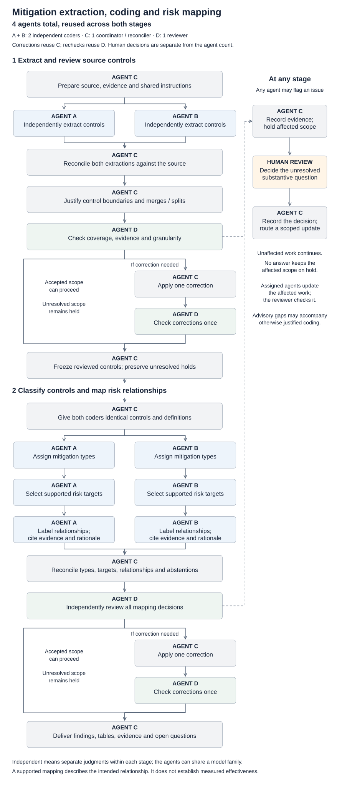

# Mitigation extraction, coding and risk mapping

The mitigation workflow turns source documents into reviewed controls, assigns mitigation types, and records which risks each control addresses and how. Two agents make independent judgments at each coding stage; a reconciler resolves differences against the source, and a separate reviewer checks the results, including cases where the coders agree.

**Four agents work across the complete process.** The same agents perform extraction and mapping, and the same reconciler and reviewer handle corrections. This is the configuration recorded in the October 1, 2026 Seoul safety-science and AI Data Security pilots. Other historical corpus runs and cross-document consolidation have their own review histories.

[Open the full-size flowchart](figures/mitigation-coding-process.svg) · [Editable diagram source](figures/mitigation-coding-process.mmd)

## Agent roles and counts

| Agent | Extraction stage | Classification and mapping stage |
| --- | --- | --- |
| **A — independent coder** | Reads the complete source and proposes controls, evidence and control boundaries. | Assigns mitigation types, selects supported risk targets, and records relationships, evidence and reasons for abstention. |
| **B — independent coder** | Independently performs the same extraction without seeing A’s output. | Independently performs the same complete mapping assessment without seeing A’s mapping output. |
| **C — coordinator and reconciler** | Prepares inputs, reconciles both extractions, justifies grouping and splitting, applies any correction, and freezes reviewed records. | Prepares shared definition packets, reconciles both mapping outputs, applies any correction, and assembles the delivery. |
| **D — independent reviewer** | Checks the reconciled results against the whole source, including omissions and granularity, then checks any corrections. | Checks types, targets, relationships, evidence and abstentions, then checks any corrections. |

Each stage therefore has **two coding agents, one reconciler and one reviewer**. These are the same four agents across both stages, not eight distinct agents. Coordination is part of C’s role. Human decisions are separate from the agent count. The pilots used agents from the same model family; independent passes do not constitute cross-model replication or human validation.

## Extraction and control boundaries

C fixes the source edition and checks the text, tables, figures and evidence context. A and B independently read the complete source and preserve the actor, action, object, conditions, exceptions and force of each proposed control.

C accounts for both proposals, including retained, merged, split, excluded and held records. The unit is an **independently meaningful intervention at the level described by the source**. Dependent procedural steps stay together; headings, examples and repeated mentions do not automatically become additional controls. For example, collecting reports, recording severity and routing urgent cases may be implementation steps within one incident-reporting procedure.

D checks whole passages against the resulting control groups. This review covers omissions, over-splitting, over-merging, lost qualifications and duplicate counting even where A and B agreed. C may apply one consolidated correction; D checks the changed records and affected context once. Accepted records move into mapping while unresolved scope remains explicitly held.

## Types, risk targets and relationships

C provides A and B with identical reviewed controls, governing context, mitigation-type definitions and pinned risk-taxonomy definitions. The documented pilots used **prototype taxonomy v0.9.3**; historical mappings retain the versions under which they were produced.

Both coders independently complete all three mapping tasks:

1. **Mitigation type:** identify what kind of intervention the control describes.
2. **Risk target:** select the most specific target or targets supported by the source and taxonomy definitions.
3. **Relationship and evidence:** state how the control relates to each target, with an exact source quotation, rationale and relevant conditions.

| Code | Relationship |
| --- | --- |
| D | Direct reduction |
| C | Conditional or mediated reduction |
| O | Observes or assesses |
| E | Enables another control |
| R | Remedy, containment or recovery |
| T | Adverse tradeoff |

Relationship codes are separate from agent labels: for example, relationship **D** means direct reduction, while **Agent D** is the reviewer.

A control can support several risk links without becoming several extracted controls. Each link requires its own support. A reasoned no-link finding, an inapplicable status and an unresolved decision remain distinct. Assessment or monitoring does not automatically imply prevention.

C reconciles type, target, relationship and evidence decisions separately. D checks every resulting assessment, including agreements, potentially omitted links and no-link reasons. If needed, the same C applies one correction and the same D checks it once. Mapping disagreements do not automatically reopen the underlying extraction.

## Human review and stopping rules

Any agent can flag unclear source meaning, questionable control boundaries, conflicting interpretations or poor taxonomy fit. C records the affected passages or records, evidence, uncertainty, possible interpretations and the specific human decision needed.

Unresolved scope and dependent work remain held while unaffected work continues. A justified classification can carry an advisory taxonomy-gap flag without becoming an unresolved record. When a human decides, C records the decision and routes a scoped update and verification; frozen records retain their prior versions. Silence does not resolve an issue.

Each stage permits **at most one agent correction and one recheck**. There is no automatic extra adjudicator or repeated correction loop. The final delivery separates accepted results, held decisions and advisory questions.

## Outputs and interpretation

The delivery includes source-grounded control records, mitigation types, risk-target relationships, quotations and rationales, review findings, and open human-review questions. These records make the reasoning traceable. They describe intended mechanisms and dependencies; they do not establish adoption, measured effectiveness or human-validated ground truth.

For recorded results and their limits, see the [worked example](worked-example.md), [methods and limitations](methods-and-limitations.md), and [evidence register](evidence-register.md).
